# Source graph

Where LLMeter's sources get their information, traced up to five levels deep.

- **Level 0** is the LLMeter website. **Level 1** is the sources listed in [RESOURCES.md](RESOURCES.md).
- Each arrow points from a source to a source it cites or draws data from. Repeated sources are merged into one node, and a node sits at the shortest level it is reached from.
- Pages were read on 2026-11-17. Nodes marked *not opened* are named by the source above them but were not read themselves.
- Blue nodes were expanded. Green nodes are primary data (a survey, a spec sheet, original tasks or questions), so there is nothing further to trace. Grey dashed nodes were not expanded, and the table says why.

Data: [data/source-graph.json](data/source-graph.json). This file is generated by `python3 scripts/build_source_graph.py`; edit the JSON, not this file.

## Diagram

```mermaid
graph LR
  subgraph L0["Level 0"]
    llmeter["LLMeter website"]
  end
  subgraph L1["Level 1"]
    llm_sizer["LLM Sizer"]
    artificial_analysis["Artificial Analysis"]
    metr_blog["Measuring AI Ability to Complete Long Tasks"]
    mba_note["How Many Agents Make an Engineer"]
    anthropic_s1["Anthropic, PBC Form S-1 (filed 2026-10-26)"]
  end
  subgraph L2["Level 2"]
    llm_sizer_data["llm-sizer-data (open data and formulas)"]
    hf_hub["Hugging Face Hub API (model sizes, config.json)"]
    apple_specs["Apple Mac technical specifications and config..."]
    nvidia_specs["NVIDIA published system specs (DGX Spark, GB2..."]
    llamacpp_bench["llama.cpp community Apple-silicon benchmark t..."]
    omlx_bench["oMLX community benchmark database"]
    hw_reviews["M5 Ultra reviews and measurements (Tom's Hard..."]
    runtimes["Local inference runtimes (MLX, mlx-lm, LM Stu..."]
    hle_diamond["HLE-Diamond (Humanity's Last Exam subset)"]
    terminal_bench["Terminal-Bench 4.0"]
    terminal_bench_science["Terminal-Bench-Science 0.1"]
    automationbench["AutomationBench (arXiv 2604.18934)"]
    gdp_pdf["GDP.pdf (arXiv 2607.11192)"]
    frontiercode["FrontierCode 2.0"]
    aa_omniscience["AA-Omniscience (arXiv 2511.13029)"]
    aa_briefcase["AA-Briefcase"]
    critpt["CritPt v2 (Hard Subset)"]
    provider_apis["Model providers' API list prices and live end..."]
    metr_paper["Measuring AI Ability to Complete Long Softwar..."]
    metr_th["METR Time Horizons page and TH 1.1 data"]
    hcast["HCAST: Human-Calibrated Autonomy Software Tas..."]
    re_bench["RE-Bench: Evaluating frontier AI R&D capabili..."]
    swe_bench_verified["SWE-bench Verified"]
    eval_analysis["METR eval-analysis-public (code and fits)"]
    essays["Background essays (Ngo 't-AGI', Cotra Bio Anc..."]
    vivaria["Vivaria (METR evaluation platform)"]
    mba_indep["Independent memo: AI developer agents in the USA"]
    bls_oews["BLS Occupational Employment and Wage Statisti..."]
    rack_supply["GB200/GB300 rack supply (Morgan Stanley via W..."]
    bnef["BNEF data-center grid connections (July 2026)"]
    google_io["Google I/O 2026 token volume (3.2 quadrillion..."]
    anthropic_pricing["Anthropic API list prices (Opus 5.5, Fable 5...."]
    press_rack_prices["Press-reported GB200/GB300 rack prices and me..."]
    us_law["US legal references (WARN Act, US Copyright O..."]
  end
  subgraph L3["Level 3"]
    hf_model_publishers["Model publishers' configs and model cards (e...."]
    quantizers["Quantized model uploads (Unsloth, Bartowski, ..."]
    llamacpp["llama.cpp / ggml (inference engine used for t..."]
    hle_paper["Humanity's Last Exam (arXiv 2501.14249)"]
    swaa["66 novel short software tasks (SWAA), timed w..."]
    hcast_public["hcast-public (METR task examples)"]
    picoctf["picoCTF challenges"]
    hackthebox["HackTheBox challenges"]
    task_bounty["METR task bounty (46 externally contributed t..."]
    react["ReAct: Synergizing Reasoning and Acting (arXi..."]
    ai_rd_tasks["ai-rd-tasks (RE-Bench environments)"]
    llm_foundry["LLM Foundry"]
    gpt2["GPT-2 small (model used in an RE-Bench enviro..."]
    openwebtext["OpenWebText corpus"]
    epoch_taxonomy["Epoch AI taxonomy of key areas of AI R&D"]
    swe_bench["SWE-bench (arXiv 2310.06770)"]
    bls_ecec["BLS Employer Costs for Employee Compensation,..."]
    gpu_rental["GPU rental prices at specialist clouds (Nov 2..."]
    ai_coding_market["AI coding tools market reports ($12.8B 2026; ..."]
    stanford_adp["Stanford/ADP study of early-career employment..."]
  end
  subgraph L4["Level 4"]
    hle_experts["Questions written by subject-matter experts w..."]
    gpt2_paper["Language Models are Unsupervised Multitask Le..."]
    react_benchmarks["ReAct evaluation tasks (HotpotQA, FEVER, ALFW..."]
    github_issues["Real GitHub issues and pull requests from 12 ..."]
    adp_payroll["ADP payroll records"]
  end
  subgraph L5["Level 5"]
    webtext["WebText: web pages linked from Reddit posts w..."]
    wikipedia["Wikipedia (source articles for HotpotQA and F..."]
  end
  llmeter --> llm_sizer
  llmeter --> artificial_analysis
  llmeter --> metr_blog
  llmeter --> mba_note
  llmeter --> anthropic_s1
  llm_sizer --> llm_sizer_data
  llm_sizer --> hf_hub
  llm_sizer --> apple_specs
  llm_sizer --> nvidia_specs
  llm_sizer --> llamacpp_bench
  llm_sizer --> omlx_bench
  llm_sizer --> hw_reviews
  llm_sizer --> runtimes
  llm_sizer_data --> hf_hub
  llm_sizer_data --> apple_specs
  llm_sizer_data --> nvidia_specs
  llm_sizer_data --> llamacpp_bench
  hf_hub --> hf_model_publishers
  hf_hub --> quantizers
  quantizers --> hf_model_publishers
  llamacpp_bench --> llamacpp
  artificial_analysis --> hle_diamond
  artificial_analysis --> terminal_bench
  artificial_analysis --> terminal_bench_science
  artificial_analysis --> automationbench
  artificial_analysis --> gdp_pdf
  artificial_analysis --> frontiercode
  artificial_analysis --> aa_omniscience
  artificial_analysis --> aa_briefcase
  artificial_analysis --> critpt
  artificial_analysis --> provider_apis
  hle_diamond --> hle_paper
  hle_paper --> hle_experts
  metr_blog --> metr_paper
  metr_blog --> metr_th
  metr_blog --> hcast
  metr_blog --> re_bench
  metr_blog --> swe_bench_verified
  metr_blog --> eval_analysis
  metr_blog --> essays
  metr_paper --> hcast
  metr_paper --> re_bench
  metr_paper --> swe_bench_verified
  metr_th --> hcast
  metr_th --> re_bench
  metr_th --> metr_paper
  metr_paper --> swaa
  metr_th --> swaa
  hcast --> hcast_public
  hcast --> picoctf
  hcast --> hackthebox
  hcast --> task_bounty
  hcast --> vivaria
  hcast --> react
  metr_blog --> vivaria
  re_bench --> ai_rd_tasks
  re_bench --> llm_foundry
  re_bench --> gpt2
  re_bench --> openwebtext
  re_bench --> epoch_taxonomy
  gpt2 --> gpt2_paper
  openwebtext --> gpt2_paper
  gpt2_paper --> webtext
  react --> react_benchmarks
  react_benchmarks --> wikipedia
  swe_bench_verified --> swe_bench
  swe_bench --> github_issues
  mba_note --> mba_indep
  mba_note --> bls_oews
  mba_note --> nvidia_specs
  mba_note --> metr_th
  mba_note --> rack_supply
  mba_note --> bnef
  mba_note --> google_io
  mba_note --> anthropic_pricing
  mba_note --> press_rack_prices
  mba_note --> us_law
  mba_indep --> bls_oews
  mba_indep --> bls_ecec
  mba_indep --> metr_th
  mba_indep --> anthropic_pricing
  mba_indep --> gpu_rental
  mba_indep --> ai_coding_market
  mba_indep --> stanford_adp
  stanford_adp --> adp_payroll
  class llmeter expanded
  class llm_sizer expanded
  class artificial_analysis expanded
  class metr_blog expanded
  class mba_note expanded
  class anthropic_s1 primary
  class llm_sizer_data expanded
  class hf_hub stopped
  class apple_specs primary
  class nvidia_specs primary
  class llamacpp_bench expanded
  class omlx_bench stopped
  class hw_reviews stopped
  class runtimes stopped
  class hf_model_publishers primary
  class quantizers stopped
  class llamacpp stopped
  class hle_diamond expanded
  class terminal_bench stopped
  class terminal_bench_science stopped
  class automationbench stopped
  class gdp_pdf stopped
  class frontiercode stopped
  class aa_omniscience stopped
  class aa_briefcase primary
  class critpt stopped
  class provider_apis primary
  class hle_paper expanded
  class hle_experts primary
  class metr_paper expanded
  class metr_th expanded
  class hcast expanded
  class re_bench expanded
  class swe_bench_verified expanded
  class eval_analysis stopped
  class essays stopped
  class swaa primary
  class hcast_public primary
  class picoctf primary
  class hackthebox primary
  class task_bounty primary
  class vivaria stopped
  class react expanded
  class ai_rd_tasks primary
  class llm_foundry stopped
  class gpt2 expanded
  class openwebtext expanded
  class epoch_taxonomy stopped
  class gpt2_paper expanded
  class webtext primary
  class react_benchmarks expanded
  class wikipedia primary
  class swe_bench expanded
  class github_issues primary
  class mba_indep expanded
  class bls_oews primary
  class rack_supply stopped
  class bnef stopped
  class google_io stopped
  class anthropic_pricing primary
  class press_rack_prices stopped
  class us_law primary
  class bls_ecec primary
  class gpu_rental stopped
  class ai_coding_market stopped
  class stanford_adp expanded
  class adp_payroll primary
  classDef expanded fill:#dbeafe,stroke:#1d4ed8,color:#0b1b3f
  classDef primary fill:#dcfce7,stroke:#15803d,color:#052e16
  classDef stopped fill:#f3f4f6,stroke:#9ca3af,color:#374151,stroke-dasharray: 4 3
```

## Nodes by level

### Level 0 (1)

| Source | Publisher | Reached from | Read | Status |
| --- | --- | --- | --- | --- |
| [LLMeter website](https://maxgerashenko.github.io/LLMeter/) | LLMeter | - | not opened | expanded |

### Level 1 (5)

| Source | Publisher | Reached from | Read | Status |
| --- | --- | --- | --- | --- |
| [LLM Sizer](https://www.theaibridges.com/tools/llm-sizer) | The AI Bridge (built by Alex Grankin) | LLMeter website | 2026-11-17 | expanded |
| [Artificial Analysis](https://artificialanalysis.ai/) | Artificial Analysis | LLMeter website | 2026-11-17 | expanded |
| [Measuring AI Ability to Complete Long Tasks](https://metr.org/blog/2025-03-19-measuring-ai-ability-to-complete-long-tasks/) | METR (Kwa, West, Becker et al.), 2025-03-19 | LLMeter website | 2026-11-17 | expanded |
| [How Many Agents Make an Engineer](https://github.com/maxgerashenko/modernMBA/blob/main/research/ai-developer-replacement-usa.md) | Max Gerashenko, modernMBA repo | LLMeter website | 2026-11-17 | expanded |
| [Anthropic, PBC Form S-1 (filed 2026-10-26)](https://www.sec.gov/Archives/edgar/data/0002130357/000162828026067168/anthropicpbc-sx1.htm) | Anthropic, PBC, filed with the U.S. Securities and Exchange Commission | LLMeter website | 2026-11-18 | primary data (the company's own financial statements; 2023 to 2025 audited, 2026 interim periods unaudited) |

### Level 2 (34)

| Source | Publisher | Reached from | Read | Status |
| --- | --- | --- | --- | --- |
| [llm-sizer-data (open data and formulas)](https://github.com/alexgrankinukr-hash/llm-sizer-data) | Alex Grankin | LLM Sizer | 2026-11-17 | expanded |
| [Hugging Face Hub API (model sizes, config.json)](https://huggingface.co/) | Hugging Face | LLM Sizer | not opened | not expanded: aggregator of thousands of uploads; expanded only to the groups LLM Sizer names |
| [Apple Mac technical specifications and configurator](https://www.apple.com/mac/compare/) | Apple | LLM Sizer | not opened | primary data (manufacturer spec) |
| [NVIDIA published system specs (DGX Spark, GB200 NVL72)](https://www.nvidia.com/en-us/data-center/gb200-nvl72/) | NVIDIA | LLM Sizer, How Many Agents Make an Engineer | not opened | primary data (manufacturer spec) |
| [llama.cpp community Apple-silicon benchmark table](https://github.com/ggml-org/llama.cpp/discussions/4167) | ggml-org / llama.cpp community | LLM Sizer | not opened | expanded |
| [oMLX community benchmark database](https://omlx.ai/) | oMLX | LLM Sizer | not opened | not expanded: site not opened |
| M5 Ultra reviews and measurements (Tom's Hardware, MacStories, Alex Ziskind, mac-llm-bench) | - | LLM Sizer | not opened | not expanded: cited by name only, no links given |
| [Local inference runtimes (MLX, mlx-lm, LM Studio, Ollama, vLLM, exo)](https://github.com/ml-explore/mlx) | - | LLM Sizer | not opened | not expanded: software, not a data source |
| [HLE-Diamond (Humanity's Last Exam subset)](https://lastexam.ai/blog/hle-diamond) | Center for AI Safety and Scale AI, 2026-09-22 | Artificial Analysis | 2026-11-17 | expanded |
| [Terminal-Bench 4.0](https://www.tbench.ai/) | Stanford researchers and the Laude Institute | Artificial Analysis | not opened | not expanded: tasks written by contributors; dataset at https://github.com/harbor-framework/terminal-bench |
| [Terminal-Bench-Science 0.1](https://terminal-bench-science.ai/) | Stanford, Terminal-Bench and Harbor team | Artificial Analysis | not opened | not expanded: tasks contributed by scientists |
| [AutomationBench (arXiv 2604.18934)](https://arxiv.org/abs/2604.18934) | Zapier | Artificial Analysis | not opened | not expanded: paper not opened |
| [GDP.pdf (arXiv 2607.11192)](https://surgehq.ai/benchmarks/gdp-pdf) | Surge AI | Artificial Analysis | not opened | not expanded: paper not opened |
| [FrontierCode 2.0](https://cognition.com/blog/frontier-code-2.0) | Cognition | Artificial Analysis | not opened | not expanded: built with open-source repo maintainers; post not opened |
| [AA-Omniscience (arXiv 2511.13029)](https://arxiv.org/abs/2511.13029) | Artificial Analysis | Artificial Analysis | not opened | not expanded: paper not opened |
| [AA-Briefcase](https://huggingface.co/datasets/ArtificialAnalysis/AA-Briefcase-Lite) | Artificial Analysis | Artificial Analysis | not opened | primary data (Artificial Analysis's own benchmark) |
| [CritPt v2 (Hard Subset)](https://artificialanalysis.ai/evaluations/critpt-v2) | - | Artificial Analysis | not opened | not expanded: Artificial Analysis gives no origin or link |
| [Model providers' API list prices and live endpoints](https://artificialanalysis.ai/methodology/performance-benchmarking) | - | Artificial Analysis | 2026-11-17 | primary data (measured by Artificial Analysis against provider APIs) |
| [Measuring AI Ability to Complete Long Software Tasks (arXiv 2503.14499)](https://arxiv.org/abs/2503.14499) | METR, v1 2025-03-18, v4 2026-07-10 | Measuring AI Ability to Complete Long Tasks | 2026-11-17 | expanded |
| [METR Time Horizons page and TH 1.1 data](https://metr.org/time-horizons/) | METR | Measuring AI Ability to Complete Long Tasks, How Many Agents Make an Engineer | 2026-11-17 | expanded |
| [HCAST: Human-Calibrated Autonomy Software Tasks (arXiv 2503.17354)](https://arxiv.org/abs/2503.17354) | METR (Rein et al.), 2025 | Measuring AI Ability to Complete Long Tasks | 2026-11-17 | expanded |
| [RE-Bench: Evaluating frontier AI R&D capabilities (arXiv 2411.15114)](https://metr.org/blog/2024-11-22-evaluating-r-d-capabilities-of-llms/) | METR, 2024-11-22 | Measuring AI Ability to Complete Long Tasks | 2026-11-17 | expanded |
| [SWE-bench Verified](https://openai.com/index/introducing-swe-bench-verified/) | OpenAI, 2024 | Measuring AI Ability to Complete Long Tasks | not opened | expanded |
| [METR eval-analysis-public (code and fits)](https://github.com/METR/eval-analysis-public) | METR | Measuring AI Ability to Complete Long Tasks | not opened | not expanded: analysis code |
| [Background essays (Ngo 't-AGI', Cotra Bio Anchors, Forethought, Amodei 'Machines of Loving Grace')](https://www.alignmentforum.org/posts/BoA3agdkAzL6HQtQP/clarifying-and-predicting-agi) | - | Measuring AI Ability to Complete Long Tasks | not opened | not expanded: framing references, not data |
| [Vivaria (METR evaluation platform)](https://github.com/METR/vivaria) | METR | Measuring AI Ability to Complete Long Tasks | not opened | not expanded: software |
| [Independent memo: AI developer agents in the USA](https://github.com/maxgerashenko/modernMBA/blob/main/research/ai-developer-agents-independent-usa.md) | modernMBA repo, dated 2026-11-10 | How Many Agents Make an Engineer | 2026-11-17 | expanded |
| [BLS Occupational Employment and Wage Statistics, May 2025 (SOC 15-1252, 15-1253)](https://www.bls.gov/oes/) | US Bureau of Labor Statistics | How Many Agents Make an Engineer | not opened | primary data (government survey) |
| GB200/GB300 rack supply (Morgan Stanley via Wallstreetcn; TrendForce Aug 2026) | - | How Many Agents Make an Engineer | not opened | not expanded: cited by name only, no links given |
| [BNEF data-center grid connections (July 2026)](https://about.bnef.com/) | BloombergNEF | How Many Agents Make an Engineer | not opened | not expanded: cited by name only; likely paywalled |
| [Google I/O 2026 token volume (3.2 quadrillion tokens/month)](https://io.google/) | Google | How Many Agents Make an Engineer | not opened | not expanded: cited by name only |
| [Anthropic API list prices (Opus 5.5, Fable 5.1, Sonnet 5.5)](https://www.anthropic.com/pricing) | Anthropic | How Many Agents Make an Engineer | not opened | primary data (vendor price list) |
| Press-reported GB200/GB300 rack prices and memory price moves | - | How Many Agents Make an Engineer | not opened | not expanded: cited by name only, no links given |
| [US legal references (WARN Act, US Copyright Office human-authorship guidance)](https://www.copyright.gov/ai/) | - | How Many Agents Make an Engineer | not opened | primary data (law and agency guidance) |

### Level 3 (20)

| Source | Publisher | Reached from | Read | Status |
| --- | --- | --- | --- | --- |
| Model publishers' configs and model cards (e.g. Qwen, Meta Llama, Mistral, Google Gemma) | - | Hugging Face Hub API (model sizes, config.json) | not opened | primary data (publisher's own model files) |
| Quantized model uploads (Unsloth, Bartowski, LM Studio community, mlx-community, ggml-org) | - | Hugging Face Hub API (model sizes, config.json) | not opened | not expanded: each upload derives from a publisher model (see previous node) |
| [llama.cpp / ggml (inference engine used for the measurements)](https://github.com/ggml-org/llama.cpp) | - | llama.cpp community Apple-silicon benchmark table | not opened | not expanded: software, not a data source |
| [Humanity's Last Exam (arXiv 2501.14249)](https://arxiv.org/abs/2501.14249) | Phan et al., CAIS and Scale AI, 2025 | HLE-Diamond (Humanity's Last Exam subset) | not opened | expanded |
| [66 novel short software tasks (SWAA), timed with human experts](https://arxiv.org/abs/2503.14499) | METR | Measuring AI Ability to Complete Long Software Tasks (arXiv 2503.14499), METR Time Horizons page and TH 1.1 data | not opened | primary data (METR's own tasks and human timings) |
| [hcast-public (METR task examples)](https://github.com/METR/hcast-public) | METR | HCAST: Human-Calibrated Autonomy Software Tasks (arXiv 2503.17354) | not opened | primary data (METR's own tasks) |
| [picoCTF challenges](https://picoctf.org/) | Carnegie Mellon University | HCAST: Human-Calibrated Autonomy Software Tasks (arXiv 2503.17354) | not opened | primary data (CTF challenges by Carnegie Mellon) |
| [HackTheBox challenges](https://www.hackthebox.com/) | Hack The Box | HCAST: Human-Calibrated Autonomy Software Tasks (arXiv 2503.17354) | not opened | primary data (commercial CTF platform) |
| [METR task bounty (46 externally contributed tasks)](https://taskdev.metr.org/introduction/) | METR | HCAST: Human-Calibrated Autonomy Software Tasks (arXiv 2503.17354) | not opened | primary data (contributed tasks) |
| [ReAct: Synergizing Reasoning and Acting (arXiv 2210.03629)](https://arxiv.org/abs/2210.03629) | Yao et al., 2023 | HCAST: Human-Calibrated Autonomy Software Tasks (arXiv 2503.17354) | not opened | expanded |
| [ai-rd-tasks (RE-Bench environments)](https://github.com/METR/ai-rd-tasks) | METR | RE-Bench: Evaluating frontier AI R&D capabilities (arXiv 2411.15114) | not opened | primary data (METR's own environments, built from scratch) |
| [LLM Foundry](https://github.com/mosaicml/llm-foundry) | MosaicML / Databricks | RE-Bench: Evaluating frontier AI R&D capabilities (arXiv 2411.15114) | not opened | not expanded: software |
| [GPT-2 small (model used in an RE-Bench environment)](https://github.com/openai/gpt-2) | OpenAI | RE-Bench: Evaluating frontier AI R&D capabilities (arXiv 2411.15114) | not opened | expanded |
| [OpenWebText corpus](https://skylion007.github.io/OpenWebTextCorpus/) | Gokaslan and Cohen, 2019 | RE-Bench: Evaluating frontier AI R&D capabilities (arXiv 2411.15114) | not opened | expanded |
| [Epoch AI taxonomy of key areas of AI R&D](https://epoch.ai/) | Epoch AI | RE-Bench: Evaluating frontier AI R&D capabilities (arXiv 2411.15114) | not opened | not expanded: not linked by METR |
| [SWE-bench (arXiv 2310.06770)](https://arxiv.org/abs/2310.06770) | Jimenez et al., Princeton, 2023 | SWE-bench Verified | not opened | expanded |
| [BLS Employer Costs for Employee Compensation, June 2026](https://www.bls.gov/ncs/ect/) | US Bureau of Labor Statistics | Independent memo: AI developer agents in the USA | not opened | primary data (government survey) |
| GPU rental prices at specialist clouds (Nov 2026) | - | Independent memo: AI developer agents in the USA | not opened | not expanded: cited by name only |
| AI coding tools market reports ($12.8B 2026; Cognition, Cursor, Claude Code revenue) | - | Independent memo: AI developer agents in the USA | not opened | not expanded: cited by name only |
| [Stanford/ADP study of early-career employment (Brynjolfsson, Chandar, Chen 2025)](https://digitaleconomy.stanford.edu/) | Stanford Digital Economy Lab | Independent memo: AI developer agents in the USA | not opened | expanded |

### Level 4 (5)

| Source | Publisher | Reached from | Read | Status |
| --- | --- | --- | --- | --- |
| [Questions written by subject-matter experts worldwide](https://lastexam.ai/) | - | Humanity's Last Exam (arXiv 2501.14249) | not opened | primary data (original expert-written questions) |
| [Language Models are Unsupervised Multitask Learners (GPT-2 paper)](https://cdn.openai.com/better-language-models/language_models_are_unsupervised_multitask_learners.pdf) | Radford et al., OpenAI, 2019 | GPT-2 small (model used in an RE-Bench environment), OpenWebText corpus | not opened | expanded |
| ReAct evaluation tasks (HotpotQA, FEVER, ALFWorld, WebShop) | - | ReAct: Synergizing Reasoning and Acting (arXiv 2210.03629) | not opened | expanded |
| [Real GitHub issues and pull requests from 12 popular Python repositories](https://github.com/) | - | SWE-bench (arXiv 2310.06770) | not opened | primary data (open-source project history) |
| [ADP payroll records](https://www.adp.com/) | ADP | Stanford/ADP study of early-career employment (Brynjolfsson, Chandar, Chen 2025) | not opened | primary data (private payroll records, not public) |

### Level 5 (2)

| Source | Publisher | Reached from | Read | Status |
| --- | --- | --- | --- | --- |
| WebText: web pages linked from Reddit posts with 3+ karma | OpenAI | Language Models are Unsupervised Multitask Learners (GPT-2 paper) | not opened | primary data (scraped web pages); level-5 leaf |
| [Wikipedia (source articles for HotpotQA and FEVER)](https://www.wikipedia.org/) | Wikimedia | ReAct evaluation tasks (HotpotQA, FEVER, ALFWorld, WebShop) | not opened | primary data; level-5 leaf |

## Where the graph stops

- 2 chains reach level 5. Below that the graph is cut off on purpose.
- Many branches end earlier because they reach primary data (government surveys, manufacturer specs, original benchmark tasks), which has no further source.
- Others stop because the source names a reference without a link (press reports, market reports, review sites), the reference is paywalled (BloombergNEF), or Artificial Analysis gives no origin (CritPt).
- Software (runtimes, evaluation platforms, analysis code) is shown as a node but not traced further, since it is a tool rather than a source of facts.
